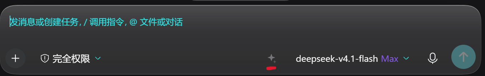

# 提示词增强 · prompt-enhance（DSH 插件）



## 插件简介

**名称**：提示词增强 · `@local/prompt-enhance` —— 把 WorkBuddy 桌面版输入框的「一键增强提示词」搬进 DeepSeek Harness：草稿一键改写、可还原、可取消。

### 核心功能

- **一键改写**：读当前草稿 → 单次无工具模型调用 → 原地替换文本
- **三种可逆操作**：增强；取消（转圈时再点一次）；还原（成功后图标变撤销箭头）
- **语言跟随**：中文进中文出、英文进英文出（模板最高优先级约束）
- **输出清洗**：剥掉代码围栏、`Enhanced prompt:` / `优化后的提示词：` 之类前缀、包裹引号，只回提示词正文
- **分歧保护**：增强成功后你若继续编辑，还原点自动失效，不会覆盖新写的内容

### 适用场景

- 需求只有一句话、但要它一次做对：`写个贪吃蛇` → 带验收条件、边界与输出格式的完整需求
- 口语化转可执行：把随口一句整理成有明确约束和结构的指令
- 跨语言 / 换语气：翻译式改写，或改得更正式、更简短，便于贴给同事或写进文档
- **不适合**：本就写得很细的提示词（模板会压缩冗余，可能删掉你要的细节）；需要读文件、跑命令的复杂任务（本插件只改文本，不执行）

### 主要特性

| 特性 | 说明 |
| --- | --- |
| 原理一致 | 逐字搬运 WorkBuddy 的 `enhance-prompt-system-prompt`（工具为空的子代理 + 约 3 KB 模板），非自造模板 |
| 模型无关 | 走当前会话的默认模型路由，不绑定厂商；请求体可覆盖 `provider` / `model` |
| 零额外依赖 | Host 只注入 `llm` + `webServer`，Client 只用 `react` + `slots`，无原生模块 |
| 原生 UI 集成 | 注册进 `conversation.input.right` 槽位，与发送键同排，不遮挡编辑器与附件栏 |
| 全本地链路 | 草稿只经过本机 DSH 的模型路由，与 WorkBuddy 客户端/服务端无任何通信 |
| 可换提示词 | 配置 `systemPrompt` 即整段替换改写策略，风格、语言、长度自定义 |

### 安装与使用概览

```bash
git clone https://github.com/qjkwjashdadwq/dsh-prompt-enhance.git
```

```
plugin_manager(action="install_bundle", target="D:\\path\\dsh-prompt-enhance")
```

刷新 Web UI → 输入框右侧出现火花按钮 → 写草稿、点击增强 → 不满意再点还原。详细步骤见下文「安装与启用」。

### 兼容性

| 项 | 说明 |
| --- | --- |
| Harness | DeepSeek Harness 桌面版 + Web UI；依赖 `@deepseek-ai/dsh-client-ui-conversation` 的槽位标准属性（`useInput`、`inputActions.setDraft`） |
| 运行平台 | Windows / macOS / Linux，纯 JS，无原生编译 |
| 模型 | 任何经 DSH `llm` 服务可用的 provider |
| 未覆盖 | 移动端 H5、CLI/TUI 等无输入框槽位的客户端形态 |

### 注意事项

- 增强会**覆盖当前草稿**：有还原点，但增强后继续编辑即失效
- 每次点击 = 一次模型调用，按你的 provider 计费
- 约 800 字是模板自带约束，不是插件硬截断
- 内联 @ 引用会被清空，附件（图片/文件）保留
- `systemPrompt` 覆盖后，WorkBuddy 原始改写行为不再保证
- `system-prompt.js` 含 WorkBuddy 提示词原文，版权归原权利人，仅作互操作与技术研究用途

---

## 安装与启用

### 前置条件

- DeepSeek Harness **桌面版**，Web UI 可正常打开；
- 至少配置了一条可用的模型路由（增强用的就是你的默认模型）。

### 方式 A：从仓库目录安装（推荐）

```bash
git clone https://github.com/qjkwjashdadwq/dsh-prompt-enhance.git
```

然后在 DSH 里执行（路径换成你本机的实际路径）：

```
plugin_manager(action="install_bundle", target="D:\\path\\dsh-prompt-enhance")
```

### 方式 B：打包成 tgz 再装

```bash
cd dsh-prompt-enhance
npm pack          # 产出 local-prompt-enhance-1.0.0.tgz
```

```
plugin_manager(action="install_bundle", target="D:\\path\\local-prompt-enhance-1.0.0.tgz")
```

### 启用校验

1. `plugin_manager` 返回 `application: applied`；
2. 插件列表出现 **提示词增强 / Prompt Enhance**；
3. **刷新 Web UI 页面**（新客户端模块需重连加载）；
4. 输入框右侧出现火花按钮，输入内容后由灰变亮。

### 停用与卸载

```
plugin_manager(action="set_plugin", target="@local/prompt-enhance", enabled=false)   # 临时停用
plugin_manager(action="remove_bundle", target="@local/prompt-enhance")                # 彻底移除
```

---

## 关键配置项

配置写在 profile 的 `cordis.patch.yml` 条目的 `config` 里；不写则全部用默认值。

| 配置项 | 类型 | 默认值 | 说明 |
| --- | --- | --- | --- |
| `temperature` | number | `0.7` | 改写发散度。想稳定贴近原句调 0.3～0.5；想更大胆扩写调 0.8～1.0 |
| `maxTextChars` | number | `32000` | 草稿长度上限，超过直接拒绝并提示 |
| `systemPrompt` | string | 空 | 非空则**整段替换** WorkBuddy 原模板，用于自定义增强风格/语言/长度 |

```yaml
- insert:
    - id: prompt-enhance
      name: '@local/prompt-enhance'
      config:
        temperature: 0.5
        maxTextChars: 20000
        systemPrompt: |
          你是提示词改写器。把用户草稿改写为更具体、可执行的版本，
          保持原语言、不超过 300 字，只输出改写后的提示词。
```

---

## 使用示例

以下为**真实调用结果**（默认模型、默认配置）。

**示例 1 · 极简中文**

> 输入：`写个贪吃蛇`

> 输出：`请实现一个完整可运行的贪吃蛇游戏。要求：基于网格的经典玩法，蛇持续移动，吃到食物后身体增长并加分；食物随机生成且不与蛇身重叠；支持方向键或WASD控制，禁止反向移动；包含撞墙和撞到自身的碰撞检测，触发后游戏结束；显示当前分数、最高分和游戏状态，最高分本地保存；提供开始、暂停、重新开始功能；游戏速度随分数提升逐渐加快；界面简洁清晰，适配常见屏幕尺寸；代码结构清晰，关键逻辑有注释；生成完整项目文件和必要配置，确保无外部服务依赖、开箱即用。`

**示例 2 · 口语化英文**

> 输入：`make the login page nicer`

> 输出：`Refine the existing login page to be more visually polished, modern, and professional while preserving all current functionality and authentication behavior. Improve layout, spacing, typography, color hierarchy, form field styling, button states, focus/hover/error states, accessibility contrast, and responsive behavior across desktop and mobile. Ensure consistency with the existing design system and branding. Do not add new login flows or change backend logic. Provide the updated implementation and a brief summary of the visual changes made.`

**示例 3 · 只想换个语气**

> 输入：`把这段改成对客户友好的说法，别太技术`

> 输出：`将下面这段内容改写为面向客户、通俗友好的表达……（保持原语言，去掉术语，保留关键信息）`

**推荐的点击时机**

- 需求只有一句话、但你要它一次做对 → 点；
- 已经写得很细、只差执行 → 不必点（模板会压缩冗余，但可能删掉你要的细节）；
- 想换风格（更短、更正式、更适合贴给同事） → 用 `systemPrompt` 改配置，比每次手写更稳。

---

## 常见问题

**Q1 刷新后没有看到按钮？**
先确认 `install_bundle` 返回的是 `application: applied`（不是 `restart-required`），再确认页面已**整页刷新**。若仍没有，检查插件是否被停用（`enabled=false`）。

**Q2 点击后转很久，或提示 `no-model-route`？**
增强走的是你的默认模型路由（`agentDefaultModel`）。没配模型、或该 provider 的密钥失效时，接口会返回结构化错误，错误原文会显示在按钮的悬浮提示里。

**Q3 点完提示 `enhance-failed` / 401 / 429？**
这是上游模型侧的问题（余额、限流、模型名失效），与本插件无关；换一条路由或稍后重试即可。

**Q4 增强后内容几乎没变？**
模型没完全遵守模板，或你的草稿本来就够详细。可把 `temperature` 调高一点，或给 `systemPrompt` 加更明确的要求（例如"至少补足 3 个可验证的验收条件"）。

**Q5 我写的中文，它回英文？**
原模板把"语言一致"列为最高优先级约束，正常不会混。若发生，多半是 `systemPrompt` 被自定义覆盖掉了那一条——把语言约束补回去。

**Q6 输入框里的附件、@ 引用会丢吗？**
附件（图片/文件）不受影响，只替换文本；**内联 @ 引用会被清空**（与 WorkBuddy 行为一致，因为参照物是整段文本替换）。含大量引用的草稿建议先复制备份。

**Q7 能换成别家模型 / 指定小模型省钱吗？**
用会话默认模型。也可在请求体里带 `provider` / `model` 覆盖（接口级用法）：

```bash
curl -s -X POST http://127.0.0.1:1144/plugins/prompt-enhance/enhance \
  -H 'content-type: application/json' \
  --data '{"text":"写个贪吃蛇","provider":"PROVIDER","model":"MODEL"}'
```

**Q8 会不会把我的草稿发给 WorkBuddy？**
不会。整个过程只经过**你本机 DSH 的模型路由**，与 WorkBuddy 客户端/服务端无任何通信；那段提示词是从其安装目录静态提取的文本。

**Q9 能只增强选中的一小段吗？**
当前版本是整段替换（与 WorkBuddy 一致）。局部增强需要走 `inputActions.captureInsertion()` 的 span 语义，尚未实现，欢迎 PR。

---

## 工作原理（可选阅读）

WorkBuddy 桌面版里，增强不是前端魔法，而是三段拼起来的：

| 组成 | 位置 | 说明 |
| --- | --- | --- |
| 子代理 | `cli/product.json` → `agents[19]` | `{ name: 'enhance-prompt', instructions: 'enhance-prompt-system-prompt', tools: [] }`——一个**没有任何工具**的子代理 |
| 系统提示词 | `cli/product.json` → `prompts[127].template` | 约 3KB 的 `enhance-prompt-system-prompt`，逐字复制到本仓库 `system-prompt.js` |
| 客户端状态机 | renderer | `enhance / enhancing / revert / error` 四态 + 原文备份 + `minTextLength=1` |

调用链：按钮 → `useEnhancePrompt` → `createEnhanceService` → IPC `llm:enhancePrompt` → 用该子代理跑一次模型调用 → **只返回改写后的提示词文本**。

移植到 DSH 后的映射：

| WorkBuddy | 本插件 |
| --- | --- |
| `llm:enhancePrompt` IPC + daemon | Host `POST /plugins/prompt-enhance/enhance` → `ctx.llm.stream()` |
| 当前会话模型 | `ctx.get('agentDefaultModel').currentSelection()` |
| 输入框文本块 | 客户端 `useInput((s) => s.draft)` |
| 替换文本块 | `inputActions.setDraft(text)` |
| `EnhanceButton` 四态 | 客户端组件状态机（loading 再点取消 / done 再点还原 / error 挂 title） |
| `\u200B` 清理、`minTextLength=1` | 两侧同名同值处理 |
| 内容被用户改动 → 撤销备份 | `useEffect` 比较 draft 与已应用文本 |

> 客户端状态机与"只输出提示词"的清洗逻辑（去代码围栏、去 `Enhanced prompt:` 前缀、去包裹引号）为本仓库在移植时补充的实现细节，非 WorkBuddy 原始代码。

---

## 目录结构

```
dsh-prompt-enhance/
├── assets/             # 截图
├── index.js            # Host：HTTP 路由、模型路由解析、流式收流、输出清洗
├── system-prompt.js    # 逐字搬运的 WorkBuddy 增强模板
├── client.js           # Client：输入框按钮 + 四态状态机
├── cordis.patch.yml    # bundle 装载条目
├── package.json        # dsh.bundle / dsh.client 声明
├── locale/{en,zh}.json # 插件列表标题与描述
└── icon.svg
```

---

## 许可

代码部分以 MIT 许可发布；`system-prompt.js` 内嵌提示词文本的版权归原权利人，见上文注意事项。
